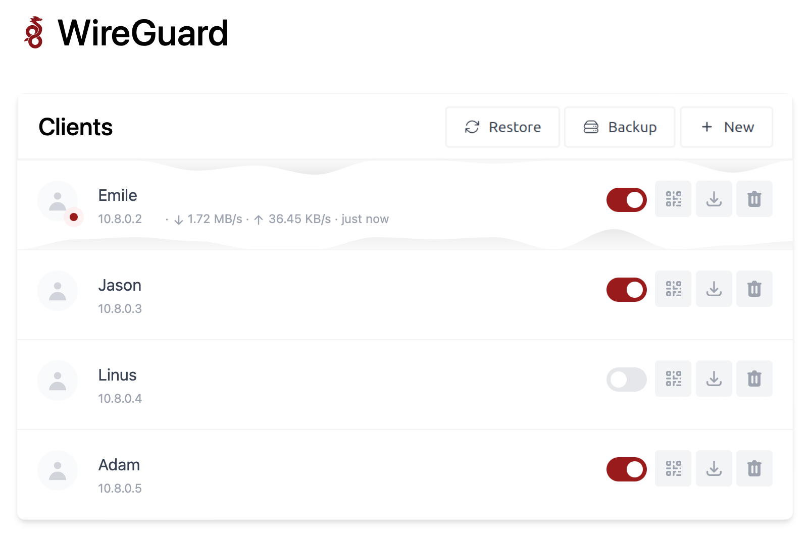

# WireGuard Easy (Custom Fork)

Docker Image: `phungvanquy/wireguard`

Easy WireGuard VPN server with a web-based management UI.

<p align="center">
  
</p>

## Features

* All-in-one: WireGuard + Web UI
* List, create, edit, delete, enable & disable clients
* QR code & configuration file download per client
* Connected client statistics with Tx/Rx charts
* Traffic quota limiting per client
* Client expiration dates
* Sort clients by name
* Backup & restore configuration
* Telegram backup integration
* Automatic Light / Dark Mode
* Multilanguage support
* Gravatar support

## Requirements

* A host with a kernel that supports WireGuard (all modern kernels)
* A host with Docker installed

## Installation

### Docker Run

```bash
docker run -d \
  --name=wg-easy \
  -e WG_HOST=<YOUR_SERVER_IP> \
  -e PASSWORD_HASH=<YOUR_ADMIN_PASSWORD_HASH> \
  -v ~/.wg-easy:/etc/wireguard \
  -p 51820:51820/udp \
  -p 51821:51821/tcp \
  --cap-add=NET_ADMIN \
  --cap-add=SYS_MODULE \
  --sysctl="net.ipv4.conf.all.src_valid_mark=1" \
  --sysctl="net.ipv4.ip_forward=1" \
  --restart unless-stopped \
  phungvanquy/wireguard
```

> 💡 Replace `YOUR_SERVER_IP` with your WAN IP or Dynamic DNS hostname.
>
> 💡 Replace `YOUR_ADMIN_PASSWORD_HASH` with a bcrypt hash. See [How_to_generate_an_bcrypt_hash.md](./How_to_generate_an_bcrypt_hash.md).

The Web UI will be available at `http://YOUR_SERVER_IP:51821`.

### Docker Compose

Download [`docker-compose.yml`](docker-compose.yml), adjust the environment variables, and run:

```bash
docker compose up -d
```

## Options

Configure via environment variables (`-e KEY="VALUE"`):

| Env | Default | Example | Description |
| --- | --- | --- | --- |
| `PORT` | `51821` | `6789` | TCP port for Web UI |
| `WEBUI_HOST` | `0.0.0.0` | `localhost` | IP address web UI binds to |
| `PASSWORD_HASH` | - | `$2y$05$Ci...` | Bcrypt hash for Web UI login |
| `WG_HOST` | - | `vpn.myserver.com` | Public hostname of your VPN server |
| `WG_DEVICE` | `eth0` | `ens6f0` | Ethernet device for WireGuard traffic forwarding |
| `WG_PORT` | `51820` | `12345` | Public UDP port for WireGuard |
| `WG_CONFIG_PORT` | `= WG_PORT` | `51820` | Port written into client configs (use when behind NAT / port mapping) |
| `WG_MTU` | `null` | `1420` | MTU for clients (server uses default WG MTU) |
| `WG_PERSISTENT_KEEPALIVE` | `0` | `25` | Keep-alive interval in seconds (0 = disabled) |
| `WG_DEFAULT_ADDRESS` | `10.8.0.x` | `10.6.0.x` | Client IP address range |
| `WG_DEFAULT_DNS` | `1.1.1.1` | `8.8.8.8, 8.8.4.4` | DNS server for clients (blank = no DNS) |
| `WG_ALLOWED_IPS` | `0.0.0.0/0, ::/0` | `192.168.15.0/24, 10.0.1.0/24` | Allowed IPs for clients |
| `WG_PRE_UP` | `...` | - | Pre-up script |
| `WG_POST_UP` | `...` | `iptables ...` | Post-up script |
| `WG_PRE_DOWN` | `...` | - | Pre-down script |
| `WG_POST_DOWN` | `...` | `iptables ...` | Post-down script |
| `LANG` | `en` | `de` | Web UI language (en, ua, ru, tr, no, pl, fr, de, ca, es, ko, vi, nl, is, pt, chs, cht, it, th, hi) |
| `UI_TRAFFIC_STATS` | `false` | `true` | Enable detailed RX/TX client stats |
| `UI_CHART_TYPE` | `0` | `1` | Chart type: 0 = disabled, 1 = line, 2 = area, 3 = bar |
| `UI_ENABLE_SORT_CLIENTS` | `false` | `true` | Enable sorting clients by name |
| `ENABLE_TRAFFIC_QUOTA` | `false` | `true` | Enable traffic quota limiting per client |
| `DEFAULT_TRAFFIC_QUOTA` | `0` | `10737418240` | Default quota in bytes (0 = unlimited). e.g. 1073741824 = 1GB |
| `TELEGRAM_BOT_TOKEN` | - | `123456:ABC...` | Telegram bot token for backup |
| `TELEGRAM_CHAT_ID` | - | `123456789` | Telegram chat ID for backup |
| `TELEGRAM_BACKUP_ENABLED` | `false` | `true` | Enable scheduled Telegram backups |
| `TELEGRAM_BACKUP_SCHEDULE` | `0 0 * * *` | `0 */6 * * *` | Cron schedule for Telegram backups |
| `TELEGRAM_BACKUP_FILENAME` | `wg0.json` | `wg0-backup.json` | Filename used for the backup sent to Telegram |

> ⚠️ If you change `WG_PORT`, make sure to also change the exposed port.

## Updating

```bash
docker compose pull
docker compose up -d
```
